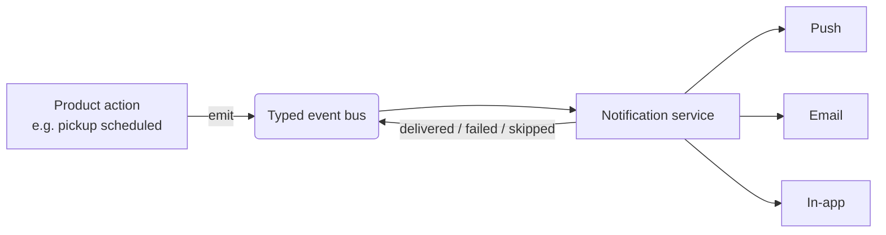

# Emit Once, Notify Anywhere

Companion repo for my talk at **App.js Conf 2026** in Kraków.

▶️ **[Watch the talk](https://www.youtube.com/watch?v=UIBd0D4ny78&t=26s)**

The talk covers how [Treasure It](https://treasureit.fun) sends push, email, and in-app notifications without spreading notification code across every feature. Product code emits one typed domain event, and a notification layer works out who should hear about it, on which channel, and what to record when a send fails.



## What's in here

| Path | What it is |
| --- | --- |
| [`packages/api/src/events`](packages/api/src/events) | A typed event bus. Each event name maps to a Zod schema, so payloads are validated before any listener runs. One listener failing doesn't stop the others; the error becomes a `system.error` event. |
| [`packages/api/src/services/notifications`](packages/api/src/services/notifications) | The notification service. It sends on each channel, then emits `notification.delivered`, `notification.failed`, or `notification.skipped` with an error code. Delivery tracking listens for those events, so the send path doesn't need to know about it. |
| [`apps/presentation`](apps/presentation) | The slide deck: Next.js, reveal.js, and tRPC. Slide changes go through the same event bus. |
| [`packages/talk`](packages/talk) | Shared Zod contracts for talk sessions and slide state. |

This demo includes only the push channel, and it runs as a dry run. Treasure It's production system adds email and in-app notifications, user preferences, and persistent delivery records. That code is private.

## Run it

```sh
bun install
bun run dev
```

The deck runs at http://localhost:305.
